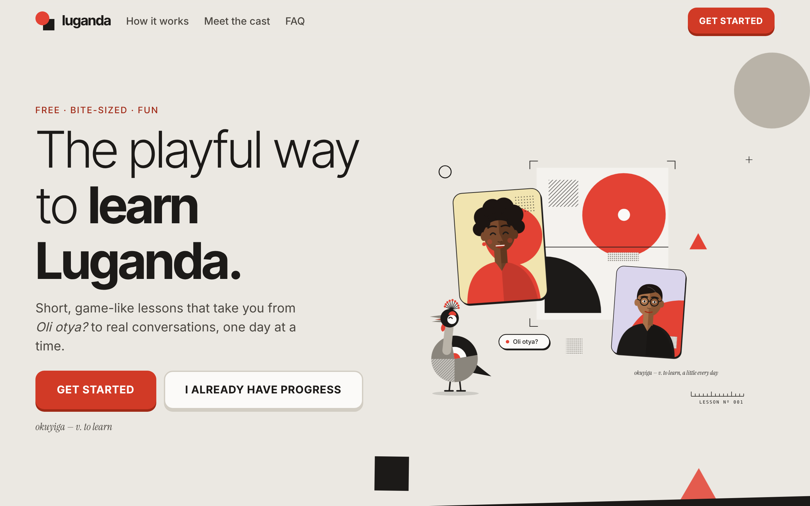
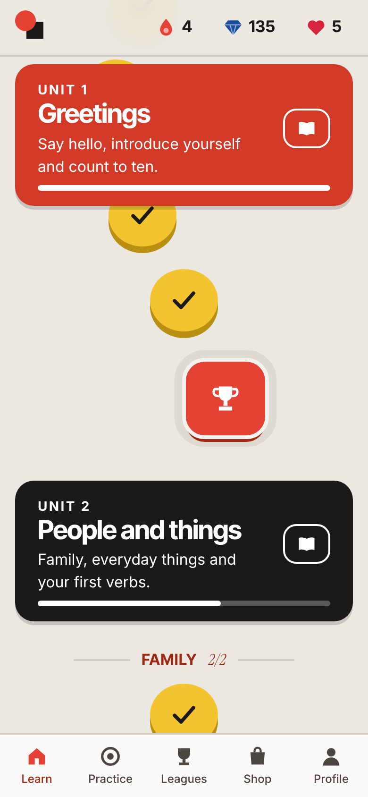
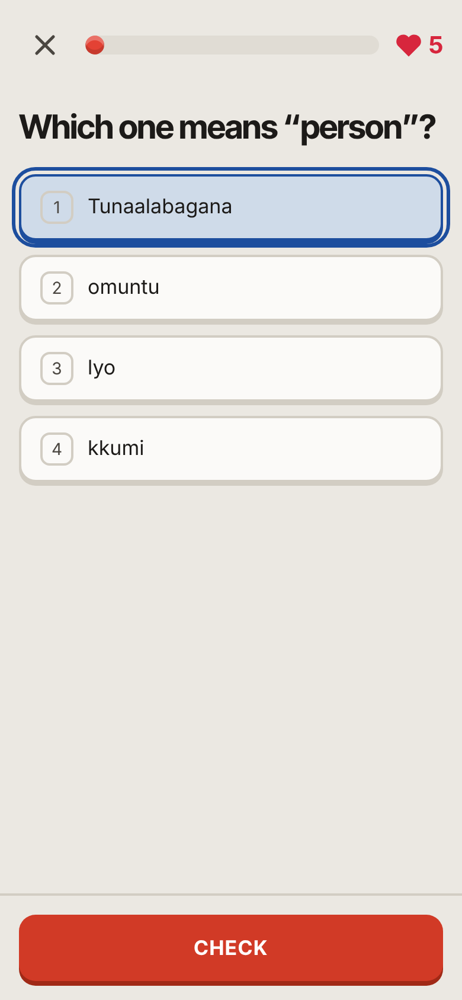
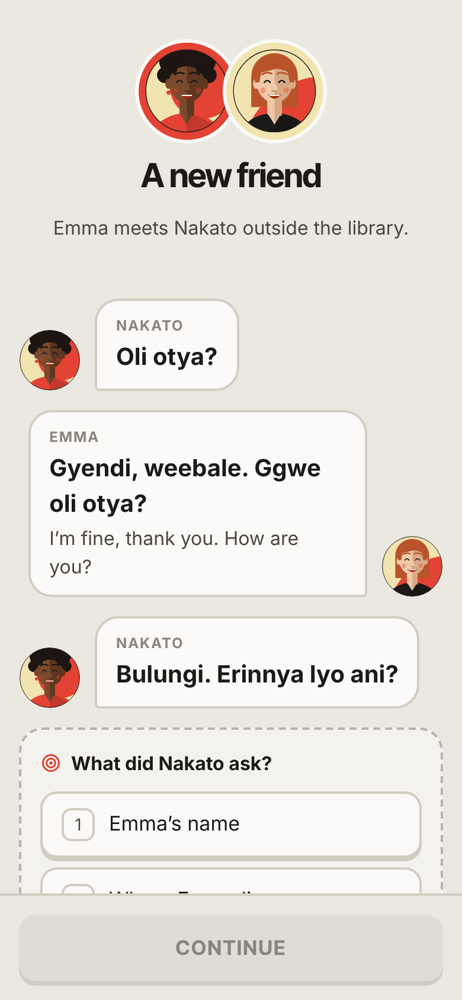
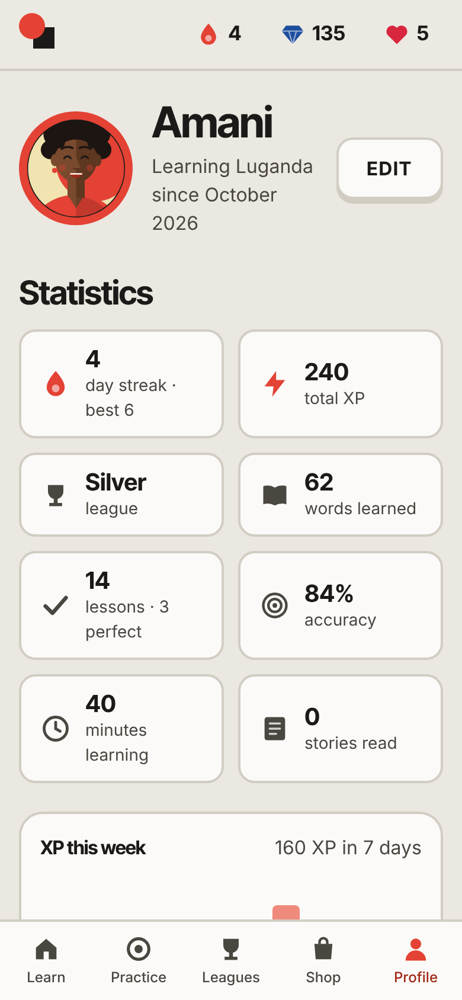

# Learn Luganda

Bite-sized, game-like lessons for Luganda, the language of Buganda in central
Uganda. Learn Luganda is a free, static web app on GitHub Pages. There are no
accounts and no server: your progress stays in your browser.

**Live:** https://jehoshaphat-obol.github.io/Learn-Luganda/



| Learning path | Lesson | Story | Profile |
| --- | --- | --- | --- |
|  |  |  |  |

## Features

- **Course**: 40 units, 341 lessons, 679 words and 21 stories in 5 sections
  (`npm run validate` prints the current totals), ending with a
  course-complete celebration.
  Learners who already know some Luganda can pass a section test to jump ahead.
  - Section 1, Foundations: greetings; people and things; food and the market;
    numbers and money; time and days; places and directions; the home; health
    and the body.
  - Section 2, Everyday life: colours and describing; clothes; my day; weather
    and seasons; animals; work and jobs; school; travel and transport.
  - Section 3, Conversations: saying no; asking questions; what I did (past
    tenses); plans (future tenses); feelings; hobbies and sport; on the phone;
    cooking.
  - Section 4, Community and culture: clans and totems; the kingdom; village
    and farming; celebrations; music and dance; faith and holidays; business;
    nature.
  - Section 5, Confident speaker: comparing; if and when; telling stories;
    proverbs; news and community; emergencies; respect and etiquette;
    folktales.
  - Each unit ends with a checkpoint and has a guidebook of key phrases,
    grammar tips and culture notes.
- **Exercises**: introductions, multiple choice, translate with a word bank or
  the keyboard, match pairs, fill in the blank, dialogues, typed answers with
  typo tolerance, and listening when audio is available.
- **Stories**: 17 illustrated conversations with the cast, with comprehension
  questions along the way.
- **Motivation**: XP and a daily goal, streaks with freezes and milestones,
  hearts that refill over time, gems, a shop, achievements with five levels
  each. It is a solo, offline app: no leagues, friends or accounts.
- **Spaced review**: words come back on a Leitner schedule. The practice hub
  offers review, mistakes and per-skill practice, and practice earns hearts
  back.
- **Your profile**: stats, an XP-this-week chart, and editable name, avatar,
  daily goal, sound, animations and reminders. You can export and import
  your progress as JSON.
- **Installable and offline**: it's a PWA with a service worker, so lessons
  work offline after your first visit. Opt-in daily reminders work while the
  app is open.
- **Accessible**: the app is checked with axe and can be played by keyboard
  alone. It respects reduced motion, gives screen readers live feedback, and
  never uses colour alone to signal right or wrong.
- **Design**: a light "promada paper" theme with vermillion orange and
  Bauhaus-style characters, avatars and a crowned-crane mascot.

- **Ads (off until configured)**: native-style AdSense cards labelled
  Sponsored, governed by a frozen rule-based policy in `src/ads/policy.js`
  with one level to tune how much they touch learning. Setup and tuning:
  [docs/adsense.md](docs/adsense.md).

## Develop

```sh
npm install
npm run dev       # local dev server
npm run validate  # check course content (units, stories, guidebooks)
npm test          # unit tests (Vitest)
npm run build     # production build into dist/ (also writes the service worker)
npm run e2e       # end-to-end tests (Playwright, against the production build)
```

Requires Node 20.19+ (CI uses Node 22). For the end-to-end tests, run
`npx playwright install chromium` once.

## Deploy

Every push and pull request runs `.github/workflows/deploy.yml`: content
validation, unit tests, the build and the end-to-end tests. On `main` it then
publishes `dist/` to the `gh-pages` branch, which Pages serves (Settings →
Pages → Source: Deploy from a branch, `gh-pages` / root).

## Project layout

- `src/content/`: the course as plain data
  - `units/`: words, sentences, skills and lessons
  - `stories.js`
  - `guidebooks.js`
  - `validate.js`: the content checks
- `src/lesson/`: exercise generation (seeded), answer checking, sessions, and
  one renderer per exercise type
- `src/state/`: the versioned localStorage store and the learning mechanics:
  XP, hearts, streaks, review, shop, achievements, stories and stats
- `src/views/`: one module per screen; `src/app/`: router, shell, PWA
- `src/ads/`: ad policy, AdSense IDs, consent and the ad card
- `src/ui/`: components, icons, avatars, badges, sound, motion and the bar chart
- `src/illustrations/`: the cast, the mascot and scenes, drawn as SVG
- `build/`: the Vite plugin that generates the service worker
- `e2e/`: Playwright tests; `tests/`: Vitest unit tests
- `journal/`: the development log, one entry per issue

## Content review

All Luganda content needs a native-speaker review before it can be called
authoritative. The checklists are in
`journal/2026-10-21-course-content.md` and
`journal/2026-10-21-units-3-8.md`. Corrections are very welcome: open an issue
or a pull request against `src/content/`.
